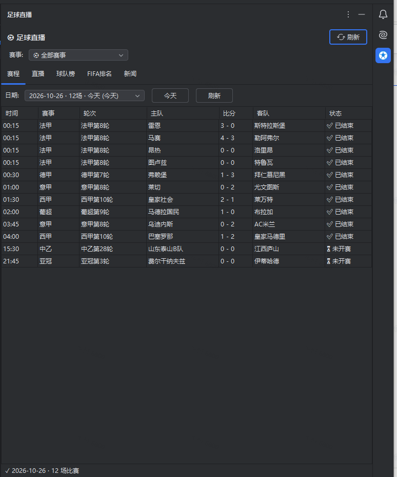
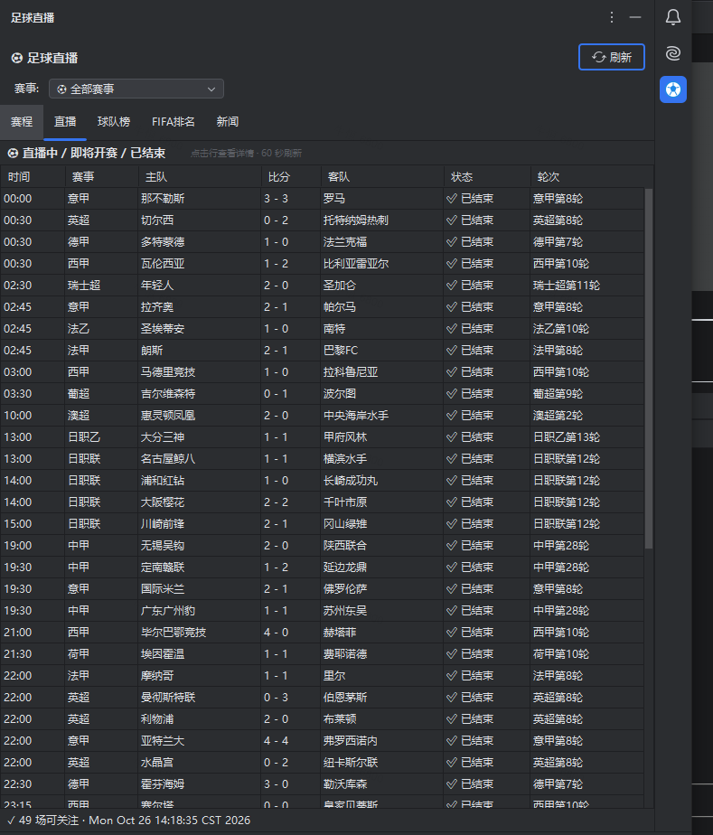
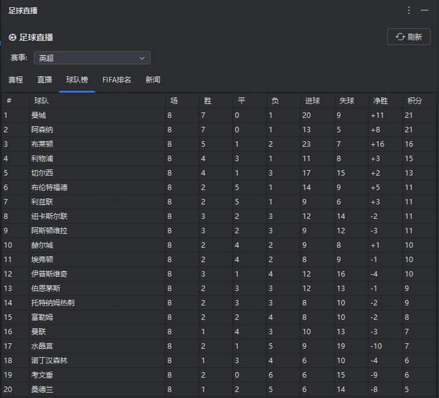

# ⚽ Football Live（足球直播）— IDEA 全赛事足球直播插件

> 在 IntelliJ IDEA 中实时追踪全球足球赛事 — 五大联赛 / 欧冠 / 中超 / 世界杯等 88+ 赛事的比分、赛程、积分榜、比赛详情、新闻一站式查看。

[](https://www.jetbrains.com/idea/)
[](https://www.oracle.com/java/)
[]()
[]()

---

## 🌟 项目简介

**Football Live（足球直播）** 是一款专为开发者设计的 IntelliJ IDEA 插件，在你写代码的同时关注全球足球赛事动态 — 完全无需注册、无需 API token、零配置开箱即用。

- **全赛事覆盖**：自动拉取百度体育赛事目录（88+ 联赛/杯赛，30 分钟缓存），顶部选择条一键切换
- **数据主源**：百度体育（tiyu.baidu.com，中文数据、纯 JSON API 形态直连）；TheSportsDB 公共 API 作为降级备用
- **插件 ID 不变**（`com.fifa.plugin.worldcup2026`）：从原 FIFA World Cup 2026 版本平滑升级，配置保留

---

## ✨ 核心功能

### 🏆 全局赛事选择条

工具窗顶部横条：**全部赛事 ｜ 关注赛事 ｜ 完整目录（88+ 赛事）**。切换后 **所有 Tab 即时联动刷新**，无需手动点刷新按钮。

### 📅 5 大功能 Tab（右侧 ToolWindow）

| Tab | 说明 | 数据源 |
|---|---|---|
| 🗓️ **赛程** | 所选赛事近 3 天赛程，按日期切换，显示主客队、比分、轮次、状态，**30 秒自动刷新** | 百度体育 |
| 🔴 **直播** | 正在直播 / 即将开赛 / 已结束的比赛，**60 秒自动刷新**；点击行弹窗看详情 | 百度体育 |
| 🌐 **球队榜** | 所选赛事积分榜拍平后的跨组/跨榜总排名（胜/平/负/进失球/净胜/积分），**60 秒自动刷新** | 百度体育 |
| 🌍 **FIFA排名** | FIFA 官方 211 队全球排名（含变化箭头），**30 分钟自动刷新** | 百度体育 |
| 📰 **新闻** | 所选赛事相关新闻卡片流，**5 分钟自动刷新**，点击跳浏览器 | 百度体育 |

### 💬 比赛详情弹窗（点击直播 Tab 任意一行）

- **分析 Tab**
  - 📊 **网友预测** — 主胜 / 平 / 客胜 % + 各队胜率箭头
  - 🧠 **智能预测** — 有利情报 / 不利情报双视角，主客队各自多条文字情报
  - 📜 **历史交锋 / 主队战绩 / 客队战绩** — 胜率汇总（`67% (4胜0平2负)`）+ 近期比赛比分（主队赢高亮标色）

- **文字直播 Tab**
  - ⏱️ 按时间正序展示比赛事件流
  - 🎨 类型彩色徽章（🔴 进球 / 🟡 黄牌 / 🟥 红牌 / 🔵 换人 / 🟣 点球 / ⚫ VAR）
  - 完整中文描述（分钟 + 球员 + 助攻者）

### 📊 StatusBar 实时比分 Widget

底部状态栏显示当前直播比赛比分 — 例如 `⚽ 皇马 2:1 巴萨 (67')`，点击立即手动刷新。

---

## 🚀 安装方式

### 方式一：从 JetBrains Marketplace 安装（发布后）

1. `Settings (Ctrl+Alt+S) → Plugins → Marketplace`
2. 搜索 `Football Live`
3. 点击 `Install`，重启 IDE

### 方式二：本地 zip 包安装

1. 从 [Releases](https://github.com/CaroNiu/FIFA-World-Cup-2026/releases) 下载最新 `Football-Live-x.x.x.zip`
2. `Settings → Plugins → ⚙ → Install Plugin from Disk...`
3. 选择 zip 文件，重启 IDE

### 方式三：从源码构建

```bash
git clone https://github.com/CaroNiu/FIFA-World-Cup-2026.git
cd FIFA-World-Cup-2026
gradle buildPlugin
# 产物在 build/distributions/Football-Live-4.0.0.zip
```

> 需要 JDK 17 + Gradle 9.x。仓库未提交 gradle wrapper，请使用本机 Gradle；Windows 下同样执行 `gradle` 命令。

---

## 📖 使用指南

### 第一次打开

安装完成后，IDEA 会自动：
- ✅ 在右侧工具栏注册 **足球直播** ToolWindow（⚽ 图标）
- ✅ 在 StatusBar（右下角）挂上 **实时比分 Widget**
- ✅ 启动 60 秒全赛事聚合轮询（一次请求覆盖全部比赛，StatusBar / 赛程 / 直播共享）

**你不需要做任何配置** — 没有 API key，没有用户名密码，没有 cookie，直接看比赛。

### 打开足球直播工具窗

| 操作 | 入口 |
|---|---|
| 点击右侧工具栏 ⚽ 图标 | 直接展开 |
| 菜单 `View → Tool Windows → 足球直播` | 显式打开 |
| 快捷键 | 可在 `Settings → Keymap` 中绑定 |

### 切换赛事

顶部选择条点选赛事（如 西甲 / 欧冠 / 中超），**赛程、直播、球队榜、新闻全部即时切换**，所选赛事会记住并在下次打开时恢复。

### 手动刷新

工具窗右上角有一个统一的 **🔄 刷新** 按钮。它只刷新当前可见 Tab，不会重复拉取所有数据。

### 看比赛详情

1. 切到 **直播** Tab
2. 看到正在进行 / 即将开赛 / 已结束的比赛列表
3. **点击任意一行** → 弹出比赛详情对话框
4. 在对话框顶部 Tab 切换 **分析** ↔ **文字直播**

### Tools 菜单刷新

`Tools → 刷新足球直播数据` 同样可以触发数据刷新，并通过 BALLOON 通知反馈结果。

---

## 🎨 截图

### 🗓️ 赛程 — 全部赛事近 3 天赛程，按日期切换



### 🔴 直播 — 直播中 / 即将开赛 / 已结束（60 秒自动刷新）



### 🌐 球队榜 — 所选赛事积分榜跨组总排名（图示：英超）



---

## 🏗️ 技术架构

### 兼容性

| 项 | 要求 |
|---|---|
| IntelliJ IDEA | Community / Ultimate **2024.3+**（`sinceBuild=243`, `untilBuild=253.*`） |
| Java | 17 |
| 操作系统 | Windows / macOS / Linux 全平台 |
| 网络 | 仅需访问 `tiyu.baidu.com`（主）与 `www.thesportsdb.com`（备用） |

### 数据流

```
[百度体育 async JSON API (tiyu.baidu.com)]
       │ OkHttp + Gson (纯 JSON, 双模式解析兼容 SSR s-data)
       ▼
BaiduMatchListClient ──► 近 3 天全部足球比赛 + 88 赛事目录 (一次请求)
BaiduRankingsClient  ──► 所选赛事积分榜
BaiduLiveMatchClient ──► 单场详情 (预测/情报/交锋)
       │
       ▼
FootballDataManager (@Service) ── 60s 全赛事聚合轮询
       │       (StatusBar 比分 / 赛程 / 直播 共享, 请求量不随赛事数增长)
       ▼
MatchCache (Caffeine) + LeagueRegistry (赛事目录/关注/选中, 30min TTL)
       │
       ├─► StatusBar Widget
       └─► LeagueFilterBar (全局赛事选择条) → 5 个 Tab
              (各 Tab 另有独立轮询: 赛程 30s / 直播 60s / 球队榜 60s / FIFA排名 30min / 新闻 5min)
```

### 核心模块

| 包 | 职责 |
|---|---|
| `api/` | REST 客户端（`BaiduMatchListClient` 全赛事聚合、`BaiduSportsClient`、`BaiduLiveMatchClient`、`BaiduRankingsClient`、`BaiduFifaRankingsClient`、`FootballDataClient` 备用/新闻） |
| `cache/` | `MatchCache` — Caffeine 内存缓存（5min/10min TTL） |
| `core/` | `FootballDataManager` 60s 聚合调度 + `LeagueRegistry` 赛事目录/关注/选中（含监听通知） |
| `model/` | `League` + Gson DTO + `normalize()` 字段映射 |
| `settings/` | UI 偏好持久化 + 所选赛事记忆 |
| `ui/component/` | `LeagueFilterBar` 全局赛事选择条 |
| `ui/toolwindow/` | 5 个 Panel + 1 个比赛详情 Dialog |
| `ui/statusbar/` | StatusBar Widget |
| `util/TeamNames` | EN→CN 队名翻译表（TheSportsDB 备用链路使用） |

---

## 🛠️ 开发命令

```bash
# 编译
gradle compileJava

# 跑单测
gradle test

# 启动沙盒 IDE 实测
gradle runIde

# 打包插件
gradle buildPlugin
# 输出 build/distributions/Football-Live-4.0.0.zip

# 验证插件兼容性
gradle verifyPlugin

# 发布到 Marketplace
gradle publishPlugin
```

---

## 🔧 配置

> **本插件零配置** — 没有任何 API key 或 token 需要填。

唯一可配置的偏好（`Settings → Tools → 足球直播 Football Live`）：

- 仅 UI 偏好（开关之类），不影响数据来源
- 持久化到 `<config>/options/fifa-worldcup.xml`

如需切换到自有数据源，改 `BaiduMatchListClient.HOST` 等常量后重新构建即可。

---

## 📦 依赖

| 库 | 版本 | 用途 |
|---|---|---|
| OkHttp | 4.12.0 | HTTP 客户端 |
| Gson | 2.11.0 | JSON 解析 |
| Caffeine | 3.1.8 | 内存缓存 |
| Jsoup | 1.18.1 | HTML 解析（备用） |

---

## ❓ FAQ

### Q1: 为什么 StatusBar 有时不更新？
A: StatusBar 比分来自 60 秒全赛事聚合轮询，widget 文本在点击时重绘 — 没有比赛进行时显示提示文案，点击可立即刷新。

### Q2: 数据更新频率是多少？
A: 多档轮询，互不干扰：
- **全赛事聚合**（StatusBar / 赛程 / 直播共享）— 60 秒，一次请求覆盖全部比赛
- **赛程 Tab** — 30 秒
- **球队榜 Tab** — 60 秒
- **FIFA排名 Tab** — 30 分钟
- **新闻 Tab** — 5 分钟

### Q3: 球队名英文 / 中文混杂？
A: 主数据源百度体育天然中文。仅当走 TheSportsDB 备用链路时需要 `util/TeamNames` 的 EN→CN 翻译表；若发现某队漏译，可补到 `TeamNames.EN_TO_CN`。

### Q4: 插件吃多少资源？
A: 全部面板的轮询经共享缓存合并，上游请求 ≤ 1 次/分钟（失败时沿用旧数据），内存占用 < 30 MB，CPU 几乎可忽略。

### Q5: 公司网络无法访问 tiyu.baidu.com 怎么办？
A: 插件使用纯 JSON API 形态请求（非网页抓取），对代理/零信任网关兼容性好。若仍被拦截，后续版本计划支持自定义 BASE_URL 与代理设置。

### Q6: 想看某场比赛的回放视频？
A: 不支持。本插件聚焦数据展示，视频播放请用浏览器打开新闻卡片或百度体育原站。

---

## 🐛 反馈与贡献

- 报 Bug / 提需求 → [GitHub Issues](https://github.com/CaroNiu/FIFA-World-Cup-2026/issues)
- 提交 PR → 欢迎 fork 并 Pull Request
- 翻译队名 → 编辑 `src/main/java/com/fifa/plugin/util/TeamNames.java`

---

## 📄 License

MIT License © 2026 Football Live Contributors

---

## 🙏 致谢

- 数据来源：[百度体育](https://tiyu.baidu.com) + [TheSportsDB](https://www.thesportsdb.com)
- IDEA 插件平台：[IntelliJ Platform Plugin SDK](https://plugins.jetbrains.com/docs/intellij)
- 灵感来自所有热爱足球与代码的开发者 ⚽💻
